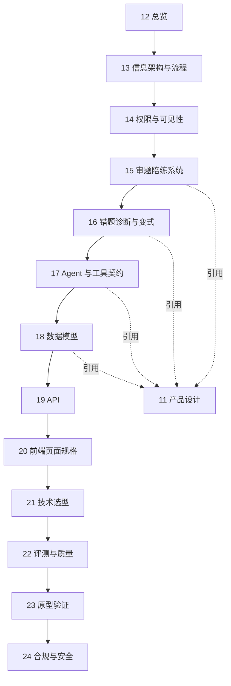

# 12. 总体架构与骨架 — 数学审题逐题陪练

> **本文档是第四部分「产品设计」的导航入口。**
> 11 号文回答 **What / Why**：产品是什么、为什么这样设计；
> 12—24 号文回答 **How**：页面怎么走、状态怎么转、数据怎么存、接口怎么定、代码骨架怎么落。
>
> 上游：`01`—`11`。下游：无。**单向依赖：后面的文档引用前面的决策，前面的不依赖后面。**

---

## 一、设计矩阵

本产品 v1 只有一个用户端：**学生端（匿名、无登录）**。
家长端、教师端在 v1 **不存在界面**，只在数据层预留只读投影。

| 设计层 | 学生端（v1） | 家长端（v2 预留） | 教师端（v2 预留） | 对应文档 |
|---|---|---|---|---|
| **信息架构** | 1 个单页 · S1—S8 | 1 条周摘要 | 1 条班级摘要 | 13 |
| **页面流程** | 1 条主流程 + 降梯/退出分支 | 只读 | 只读 | 13 |
| **权限与可见性** | 只能看自己的会话；看不到内部证据 | 只能看自己孩子的聚合 | 只能看匿名聚合 | 14 |
| **业务系统** | 审题陪练 / 卡点 / 变式与重练 | — | — | 15、16 |
| **Agent 与工具** | 1 个「审题教练」+ 6 个工具契约 | — | — | 17 |
| **数据与评测** | 会话 / 卡点 / 两个库 / Gate 0—3 | — | — | 18、22 |
| **技术基础** | 单页 HTML + 极薄 Python 后端 | ← 共享 | ← 共享 | 19、20、21 |
| **原型验证** | 1 个可交互 HTML 原型 | — | — | 23 |
| **合规与安全** | 「不给答案」形态 + 未成年人数据最小化 | ← 共享 | ← 共享 | 24 |

---

## 二、文档索引

| 编号 | 文档 | 定位 | 核心内容 |
|---|---|---|---|
| 12 | 总体架构与骨架（本文） | 导航入口 | 设计矩阵、单向依赖、骨架地图 |
| 13 | 信息架构与页面流程 | 结构与流程 | 单页 8 状态、S1—S8 流程、异常/退出分支 |
| 14 | 权限与数据可见性 | 可见性边界 | 角色 × 资源矩阵、内部记录 vs 学生可见投影 |
| 15 | 审题陪练系统设计 | 核心业务 | 会话状态机、F2 备课、F3 判定、降梯、S8 收束 |
| 16 | 错题诊断与变式/重练 | 业务系统 | 四类卡点、CheckpointEvent、变式题、两个库、未清账目 |
| 17 | Agent 与工具契约 | AI 编排 | 确定性流程编排器、6 个工具、TOOL_META、Guard L1（L2/L3 留待 v2） |
| 18 | 数据模型设计 | 数据层 | ER 图、核心实体、字段、枚举、可见性投影 |
| 19 | API 设计 | 接口层 | 端点矩阵、请求/响应、错误码、状态流转 |
| 20 | 前端页面规格 | 视觉与交互 | S1—S8 每屏的布局、组件、状态、文案 |
| 21 | 技术选型与工具链 | 技术落地 | 零依赖 Python、单页 HTML、JSONL、Web Speech、ADR |
| 22 | 评测与质量保障 | 质量体系 | Gate 0—3、L0—L6 映射、红线与门禁 |
| 23 | 原型验证 | 交付验证 | 方案七维度、三关 Review、HTML 原型、需求标注 |
| 24 | 合规与安全设计 | 不可越过的线 | 不给答案、未成年人、数据最小化、AI 标识、删除权 |
| — | `CONTEXT.md` | 横切 | 领域术语表（中英名称 / 一句话定义 / 出处） |
| — | `DESIGN.md` | 横切 | 前端视觉规范（色 / 字 / 间距 / 组件 / 断点） |

---

## 三、单向依赖



**原则**：13 定页面，14 定可见性，15/16 定业务，17 定工具，18 定数据，19 定接口，20 定像素，21 定技术；后面的文档不反过来改前面的决定。

---

## 四、骨架地图

### 4.1 代码骨架（v1）

```
数学审题逐题陪练-backend/
├── run.py                    启动入口（零依赖）
├── app/
│   ├── main.py               HTTP 服务与路由
│   ├── api/
│   │   ├── sessions.py       会话生命周期 + 答题 + 收束（S1—S8）
│   │   ├── records.py        练习记录 / 未清账目 / 重做
│   │   └── forward.py        模型读题 / 通用转发（藏 key）
│   ├── domain/
│   │   ├── schema.py         备课/卡点/练习记录契约（原 11 号文的值）
│   │   └── session_state.py  会话状态枚举与转移表
│   ├── engine/
│   │   ├── flow.py           确定性流程编排 + 顺序门
│   │   ├── prep.py           F2 备课（桩/真模型）
│   │   ├── judge.py          F3 判定（Gate 0 前固定「不判定」）
│   │   └── audit.py          可见性投影 / 答案字段剥离
│   ├── tools/
│   │   └── registry.py       TOOL_META + Guard L1（L2/L3 留待 v2）
│   └── store/
│       ├── jsonl_store.py    追加式记录（S12 两个库）
│       └── session_store.py  会话 JSON 落盘
└── tests/                    单元 + 流程 + HTTP
```

前端：`流程步骤/5.创建项目骨架/v1/index.html` —— 单页 HTML + 原生 JS，零构建；由后端 `--static` 同源发。

### 4.2 数据骨架（v1）

| 层 | 存什么 | 存哪 |
|---|---|---|
| 会话 | 一次 S1—S8 的完整状态 | `data/sessions/<id>.json` |
| 事件 | 每次状态转移 / 判定 / 卡住 | `data/session_events.jsonl`（审计；已定义未实现） |
| 记录 | 练习记录 / 卡点 / 错题 | `data/exercises.jsonl` / `beads.jsonl` / `wrong_items.jsonl` |
| 模型 | 不落原始图片；只落确认后的题目文本与派生结果 | 见 18 |

---

## 五、三条不能越过的线

1. **产品里不存在「答案」这个入口**（11·§四决策 8、24）。不是文案，是形态。
2. **批改只给数量级定位，不点名**：学生端只看到「有 N 个条件没用上」，看不到「是哪一个」。
3. **Gate 0 之前 F3 不判对错**：误判正例率 = 0 是所有家庭实测的前提；骨架里 `judge.py` 默认返回「不判定」。

---

## 六、与样板 ChemAI 的对应关系

| 样板 | 本文档套 | 同 | 不同 |
|---|---|---|---|
| 19 产品设计总览 | 12 总览 | 设计矩阵 + 单向依赖 + 文档索引 | 我们是单端单流程，不是三端 |
| 20/21 信息架构/流程 | 13 | 页面树 + 流程图 | 我们只有一个单页 8 状态，没有导航树 |
| 22 权限 | 14 | 角色 × 资源矩阵 | v1 只有学生一个角色，权限主要落在“可见性投影” |
| 23—28 业务系统 | 15、16 | 每模块：定位/目标/指标/边界/场景/流程/决策/衔接 | 我们只有审题、诊断、变式三块 |
| 29 Agent | 17 | Persona/工具/Guard/TOOL_META | **我们是确定性流程编排器，不是自由 ReAct Agent** |
| 33 数据模型 | 18 | ER + 实体 + 字段 + 枚举 | 我们只有会话/题目/备课/判定/卡点/变式/错题 |
| 34 API | 19 | 端点矩阵 + 状态码 + 契约 | 极薄后端，零框架 |
| 35/38 设计系统/前端规格 | 20 | 每屏布局/组件/状态/文案 | 单页原生 HTML，无设计系统 |
| 37 技术选型 | 21 | ADR + 够用就好 | 零依赖 Python + 单页 HTML，不是 FastAPI/React |
| 31 评测 | 22 | L0—L6 + 门禁 | 我们映射为 Gate 0—3 + 60 个测试 |
| 41 原型验证 | 23 | 四步流 + 需求标注 | 1 个原型，不是 14 个 |
| 25 安全审核 | 24 | 审核前置 | 审的是「答案泄露 / 未成年人 / 数据最小化」 |

---

## 七、阅读路径

| 你要做什么 | 先读 |
|---|---|
| 看产品全貌 | 11 → 12 |
| 改页面/交互 | 13 → 20 |
| 改流程/判定/备课 | 15 → 17 → 19 |
| 改数据结构/接口 | 18 → 19 |
| 接模型/换技术 | 17 → 21 |
| 做实测/验收 | 22 → 15 |
| 准备上线/合规 | 24 |

---

> **下一份**：[13-信息架构与页面流程](./13-信息架构与页面流程.md)

---

## 沿革

- **2026-10-30**：按 25·§2.2 修正 D5—D7（48→60 个测试；Guard 只有 L1，L2/L3 留待 v2；`session_events.jsonl` 标为已定义未实现）。
