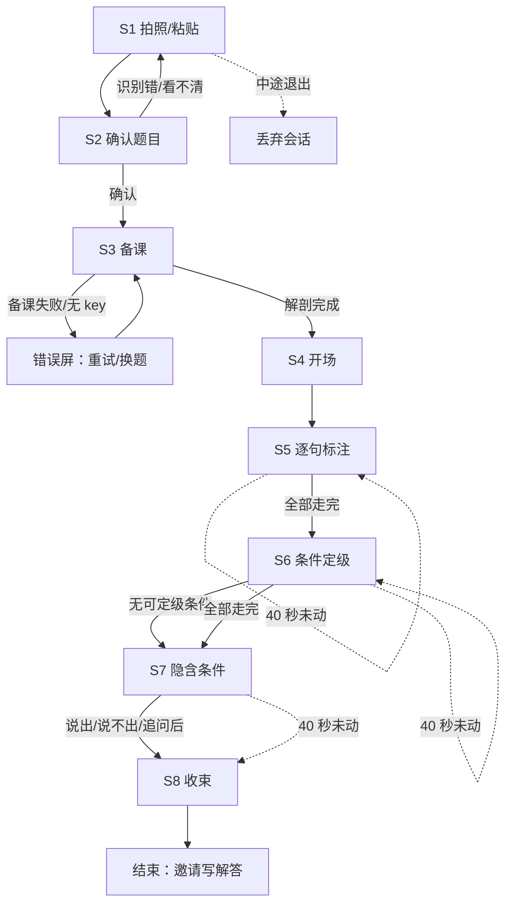

# 13. 信息架构与页面流程 — 数学审题逐题陪练

> 上游：11、12。下游：14、20。
> 本文回答两件事：**v1 有哪些页面**、**学生怎么一步步走**。

---

## 一、形态：没有首页，打开就是拍题

11·§3.1 已定：学生「卡住的时候才打开」，所以产品**没有首页、没有课程、没有列表、没有进度**。
v1 是**一个单页**，页面内的 8 个状态就是 8 个「屏」，不是 8 个路由。

| 项 | 决定 | 依据 |
|---|---|---|
| 页面数 | 1 个 HTML 页面，8 个状态 | 11·§3.1「打开就是拍题」 |
| 导航 | 无菜单、无首页、无 tab | 同上 |
| 登录 | 无 | 06·二（教师试用无登录） |
| 端 | 只做学生端 | 11·§6·决策 6 |
| 首体验终点 | S8 收束 | 11·§6·决策 1 |
| 后续弧线 | S9—S12 不在 v1 界面内 | 同上 |

> **家长端 / 教师端**：v1 不做界面；家长只有 v2 的一条周摘要，教师只有 v2 的一条班级摘要（见 14）。

---

## 二、页面清单（单页内的 8 个状态）

| 状态 | 屏名 | 学生动作 | 系统动作 | 出口 |
|---|---|---|---|---|
| **S1** | 拍照 / 粘贴 | 拍照、选图，或粘贴题目文字 | 接收图片/文本 | → S2 |
| **S2** | 确认题目 | 看一眼识别结果，改错字，点「对，继续」 | 把识别结果显式摆出来 | → S3 |
| **S3** | 备课（不可见） | 等（界面给「我在准备」信号） | F2 把题解剖一遍；产出分句/类型/级别/隐含条件集合/不确定项 | → S4 |
| **S4** | 开场 | 听第一句话，点「开始读题」 | 语音定调：不着急做、不给解法 | → S5 |
| **S5** | 逐句标注 | 对每句点选：背景/条件/问题/指令 | F3 比对；不判对错时转提问；降梯 | → S6（全部句子走完） |
| **S6** | 条件定级 | 对每条条件句点选：直接/间接/隐含 | F3 比对；灰度项只提问 | → S7（全部条件走完） |
| **S7** | 隐含条件 | 打字回答，或点「我说不出来」 | 提问 → 判 → 追问一次 → 标记并继续 | → S8 |
| **S8** | 收束 | 听总结；点「重新开始」 | 说出他做到的具体动作；首体验结束 | → 结束 / S1 |

**S9—S12（v2 / 完整闭环）**：写解答拍照 → 批改 → 变式题 → 两个库。v1 界面不出现；S8 只用一句话邀请「你可以去写了」。

---

## 三、主流程

### 3.1 每一步的进入/退出守卫

| 步骤 | 进入条件 | 退出条件 | 不允许 |
|---|---|---|---|
| S1 | 会话已创建 | 有图或有文本 | 空提交 |
| S2 | 读题完成 | 学生确认文本非空 | 跳过确认直接备课 |
| S3 | S2 确认 | 备课解剖通过 schema 校验并锁定 | 备课失败硬走 |
| S4 | 备课锁定 | 学生点「开始」 | 没备课就开场 |
| S5 | S4 完成 | 所有句子都有一次作答（或 40 秒记卡住） | 跳句、重复提交同一句 |
| S6 | S5 全部完成 | 所有条件句都有一次作答（或记卡住） | 条件未定级就进 S7 |
| S7 | S6 全部完成 | 说出、说不出来、或追问一次后 | 无限追问 |
| S8 | S7 结束 | 展示总结 | 写库失败阻塞收束 |

> 守卫由后端 `flow.py` 强制执行，前端只是渲染；不靠 prompt 自觉（见 17）。

---

## 四、异常与分支

| 情况 | 系统反应 | 学生看到 |
|---|---|---|
| 拍糊 / 识别不出 | 不猜；提示重拍或粘贴 | 「这张看不清，换一张，或者把题目粘进来」 |
| 读题有错字 | 显式摆出文本，可改 | 「有认错的字，直接改」 |
| 备课失败 / 无 key | 停在 S3，给重试；桩模式可走通 | 「我在准备时卡住了。再试一次，或先换一道题」 |
| 判定「不判定」 | **不判对错**，改问「你为什么这么想？」 | 不出现「你错了」 |
| 15 秒没动静 | 给一条线索 | 一句提示，不催 |
| 40 秒还没过 | 记「卡在这一步」，继续 | 「这一步先记下来，我们继续」 |
| S7 说不出来 | 标记（**仅 `P0_已通过` 时写卡点；否则只记 `stuck`**），继续 | 「这个我们先记下来，待会儿换个题再看看」 |
| 学生中途退出 | 会话标记 `DISCARDED`；不写脏记录 | 下次打开是新会话 |
| 服务端错误 | 结构化错误码 + 重试 | 错误屏，不吞掉 |

> **S7 的卡点前提**：卡点仅在 `judge.P0_已通过` 为真时写入；Gate 0 前「说不出来 / 追问后仍不行」只记 `stuck`，不写 `fail`（25·D8）。

---

## 五、导航规则

1. **只能向前，不能后退**：S2 之后不提供「上一步」；要重来就丢弃会话，从 S1 开始。理由：审题是线性动作，后退会让「已提交的标注」变得可改，破坏记录。
2. **S1/S2 可以重拍/重贴**：识别错是客观风险（01·T1），必须给低成本纠错入口。
3. **S3 失败不硬走**：备课错一次后面全错（02·W2）。
4. **S8 没有「再来一题」**：首体验有明确终点；只有一个小号「重新开始」（测试/二次使用），不是主 CTA。
5. **没有浮动进度条**：只在顶部显示「S5 · 逐句标注 · 第 2/5 句」，让学生知道现在在哪、下一步是什么（11·§3.1 第三点）。

---

## 六、页面与数据的依赖

| 屏 | 需要的数据 | 产出的数据 |
|---|---|---|
| S1 | 无 | `problem.image` 或 `problem.raw_text` |
| S2 | 读题结果 | `problem.confirmed_text` |
| S3 | 确认文本 | `prep`（分句/类型/级别/隐含条件/不确定项），锁定 |
| S4 | 开场话术 | — |
| S5 | `prep.分句` | 每句的 `answer` + `verdict` + 卡点 |
| S6 | `prep.分句` 中 `type=条件` | 每条条件的 `level` + `verdict` + 卡点 |
| S7 | `prep.隐含条件集合` | 学生文本 + `verdict` + 卡点（含子类） |
| S8 | 会话累积结果 | `summary`；可选写记录 |

> 字段与枚举见 18；接口见 19。

---

## 七、v2 预留（不实现，只定位置）

| 预留 | 位置 | 说明 |
|---|---|---|
| S9 写解答拍照 | S8 之后的可选后续 | 学生自己的作业时间，不计入首体验 15 分钟 |
| S10 批改 | Gate 2 通过后 | 只给数量级定位，不点名 |
| S11 变式题 | 条件触发，首体验不触发 | 源题作蓝本 → 生成 → 审核 → 交付 |
| S12 两个库 | 会话结束后 | 错题库 + 卡点记录库 |
| 家长周摘要 | v2 | 1 条、30 秒、无排名 |
| 教师班级摘要 | v2 | 匿名聚合、不点名 |

---

## 沿革

- **2026-10-30**：按 25·§2.2 修正 D8（S7 说不出仅在 `P0_已通过` 时写卡点；否则只记 `stuck`）。
