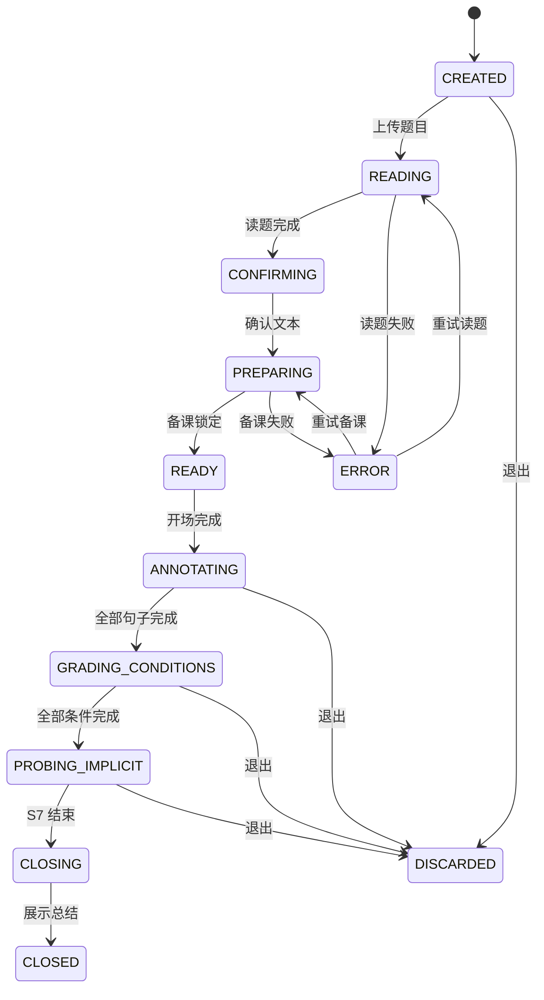

# 15. 审题陪练系统设计 — 数学审题逐题陪练

> 上游：11、13、14。下游：16、17、18、19、20。
> 本文是 v1 的核心业务系统：**一次 S1—S8 会话怎么从题目变成「读明白了」**。
> 结构对齐样板 23—28 号文的模块模板：定位 → 目标 → 指标 → 边界 → 场景 → 流程 → 决策 → 衔接。

---

## 一、定位

**把「认真读题」拆成 4—6 个可执行动作，由 AI 教练带着学生走完一遍，全程不给答案。**

它不是解题系统、不是题库、不是批改系统；v1 只做审题弧线（S1—S8）。
S9—S12（写解答/批改/变式/两个库）在 v2，见 16。

---

## 二、目标与指标

| 目标 | 指标 | 红线 |
|---|---|---|
| 学生能独立走完首体验 | 首体验完成率 ≥70% | 无人在前 3 分钟退出 |
| 首体验足够短 | 首体验（S1—S8）≤15 分钟 | >20 分钟视为失败 |
| 判定不伤害学生 | 误判正例率 = 0 | 任何 >0 都不上线 |
| 让学生说得出「我读懂了」 | S8 能复述具体动作 | — |
| 记录可用于回看 | 卡点结构稳定、可聚合 | 维度不再增加 |

> 指标来源：11·§6·决策 1、§8.3；07·S-B6/S-B9；22 号文 Gate 0—2。

---

## 三、边界

| 做 | 不做 |
|---|---|
| 逐句标注（背景/条件/问题/指令） | 不一次展示整道题的所有句子 |
| 条件三级（直接/间接/隐含） | 不与逐句标注合并 |
| 隐含条件追问（开放文本） | 不给答案、不给解法、不写完整过程 |
| 语音引导、降梯、卡点记录 | 不排名、不打分、不做无限流 |
| 首体验在 S8 收束 | v1 不做 S9—S12 界面 |

---

## 四、会话状态机

### 4.1 状态

| 状态 | 含义 | 进入 | 出口 |
|---|---|---|---|
| `CREATED` | 会话已建，未读题 | 创建 | 上传题目 |
| `READING` | 模型读题中 | 上传图片/文本 | 读题完成 / 失败 |
| `CONFIRMING` | 识别结果待学生确认 | 读题完成 | 学生确认 |
| `PREPARING` | F2 备课中 | 确认题目 | 备课锁定 / 失败 |
| `READY` | 备课锁定，可开场 | 备课成功 | 学生开始 |
| `ANNOTATING` | S5 逐句标注 | 开场完成 | 所有句子走完 |
| `GRADING_CONDITIONS` | S6 条件定级 | S5 完成 | 所有条件走完 |
| `PROBING_IMPLICIT` | S7 隐含条件 | S6 完成 | 说出/说不出/追问后 |
| `CLOSING` | S8 收束 | S7 结束 | 展示总结 |
| `CLOSED` | 首体验结束（终态） | 收束完成 | — |
| `DISCARDED` | 学生退出（终态） | 任意非终态 | — |
| `ERROR` | 可恢复错误 | 任意步骤异常 | 重试回原状态 / 丢弃 |

### 4.2 转移与守卫

**守卫（由 `flow.py` 强制执行，不靠前端）**：

| 守卫 | 规则 |
|---|---|
| G1 读题前 | 只有 `CREATED` 能上传题目 |
| G2 备课前 | 只有 `CONFIRMING` 且文本非空能备课 |
| G3 开讲前 | 只有 `READY`（备课已锁定）能进 S5 |
| G4 逐句 | S5 只能答 `prep.分句` 里的句子；同一句只能提交一次 |
| G5 定级 | 只有 S5 全部完成才能进 S6；只能答 `type=条件` 的句子 |
| G6 隐含 | 只有 S6 全部完成才能进 S7；最多追问一次 |
| G7 收束 | 只有 S7 结束才能进 S8 |
| G8 终态 | `CLOSED`/`DISCARDED` 后不可再答 |

---

## 五、F2 备课（唯一真源）

### 5.1 输入/输出

| 项 | 内容 |
|---|---|
| 输入 | S2 学生确认过的题目文本 |
| 输出 | `备课解剖`：题目原文、分句（i/text/type/level/confidence/note）、隐含条件集合、不确定项 |
| 关键 | **隐含条件是集合，不是单点**；**不确定项必须显式输出** |
| 锁 | 备课成功后 `locked=true`；后续 S5/S6/S7 与 v2 批改都只读这一份，不重新读题 |

### 5.2 规则

1. 分句按句号/问号/分号切，4—6 句为宜；每句原样保留。
2. `type` 只能是背景/条件/问题/指令；`level` 只给条件句。
3. 任何一项没把握 → `confidence=低`，写进 `不确定项`；走到那一项**不判对错，只提问**。
4. **不给答案、不给解法**；备课只做解剖，不做解题。
5. 解析失败/不合契约 → `ERROR`，不猜、不补。

### 5.3 桩模式

无 key 时可用 `PEILIAN_STUB=1`：只做分句 + 启发式分类，`confidence` 全写「低」，`不确定项` 写明「桩模式未判定」。
**桩模式只用于走通流程，不用于验证判定质量。**

---

## 六、F3 判定

### 6.1 三种输出

| 结果 | 触发 | 学生看到 |
|---|---|---|
| `一致` | 与备课一致，且备课 confidence 不是低 | 夸具体动作 + 依据 |
| `不一致` | 与备课不一致，且不是「集合外但成立」 | 不判「你错了」，指向线索 |
| `不判定` | 备课标了低 / P0 未通过 / 无法确认 | 「你为什么这么想？」（只提问） |

### 6.2 红线与顺序

- **Gate 0 之前，`judge.py` 固定返回「不判定」**（`P0_已通过=False`）。
- P0 通过后，`_判()` 才接入比对；契约不变，前端不改。
- 「集合外但成立」必须算 `一致`；误判正例率 = 0。
- 判定必须给依据（「这句话没有给出数量关系，所以不是条件句」），但**依据不能点名答案**。

### 6.3 判定与生成分离

F2 在开口前完成；F3 只做比对，不逐轮重新判断。
v2 批改也只消费锁定的 `problem_read`，不重新独立读题（见 16/样板 23 的教训）。

---

## 七、S5 / S6 / S7 的交互规则

### 7.1 通用

- 一次只推进一个对象（一句/一条条件/一个开放问题）。
- 15 秒没动静 → 一条线索；再 15 秒 → 记「卡在这一步」继续；整步上限 40 秒。
- 40 秒上限 = 一次降梯周期，从时间上强制「降梯只降一次」。
- 夸动作不夸人；不说「你错了」「你又漏了」。

### 7.2 S5 逐句标注

| 情况 | 反应 |
|---|---|
| 一致 | 「对了。像这种不讲数量、只交代情境的句子，就是背景句。」 |
| 不一致（确定） | 「它在给数字，还是在问你什么？」 |
| 不判定 | 「你为什么这么想？」 |

### 7.3 S6 条件定级

| 情况 | 反应 |
|---|---|
| 一致 | 肯定具体判断 |
| 不一致 | 「它是拿来就能用，还是要先转一步？」 |
| 灰度 | 只提问、不判级 |

### 7.4 S7 隐含条件

| 学生 | 系统 |
|---|---|
| 说出命中 | 「就是它。这句话题里一个字都没写，但它是这道题的关键。」 |
| 说了未命中 | 追问一次：「你说的这个，能再说说为什么吗？」 |
| 追问后仍不行 | 不硬逼，标记「卡点未通过」，继续 |
| 点「我说不出来」 | 同样标记，并说「这个我们先记下来，待会儿换个题再看看」 |

「说不出来」按钮：**延迟出现**（建议 15 秒后），可达但不能无摩擦；它是信号，不是失败。

---

## 八、S8 收束

- 说「这道题你已经读明白了」+ **具体动作**（「你一句一句看了 5 句，标出了 3 个条件」）。
- 不是评分，不出现分数/排名。
- 首体验在这里结束；邀请「你可以去写了——写完拍给我看」，但 S9 不在 v1 界面内。
- 判定未上线时，明确说「这次我只提问、没有判对错；没有写入卡点库」。
- 没有「再来一题」；只有小号「重新开始」。

---

## 九、关键决策

| # | 决策 | 理由 | 代价 |
|---|---|---|---|
| 1 | **备课锁定后不再重读** | 备课错一次后面全错；重读会让标准漂移 | 学生的确认成本 |
| 2 | **F3 默认不判定** | Gate 0 红线 | 首体验没有“判对错”的即时感 |
| 3 | **40 秒上限** | 强制降梯只降一次 | 有些学生可能被“记卡住” |
| 4 | **S7 只追问一次** | 避免变成审问 | 有些隐含条件没机会展开 |
| 5 | **首体验止于 S8** | 15 分钟只装得下审题弧线 | 首体验看不到“自己写”的最强证据 |
| 6 | **流程由状态机守卫，不由 LLM 自由编排** | 单流程产品要可复现 | 灵活性低，但可测 |

---

## 十、衔接

| 上游 | 本文消费 | 下游 | 本文产出 |
|---|---|---|---|
| 13 页面流程 | 8 个屏的顺序 | 16 诊断/变式 | 卡点事件、会话结果 |
| 14 可见性 | 学生只看数量级 | 17 工具 | `prep` / `verdict` 契约 |
| 11 产品设计 | S1—S8、判定三态 | 18 数据模型 | 会话实体 |
| 02/05 | 红线、指标 | 19 API | 会话端点 |

> **下一份**：[16-错题诊断与变式重练](./16-错题诊断与变式重练.md)
