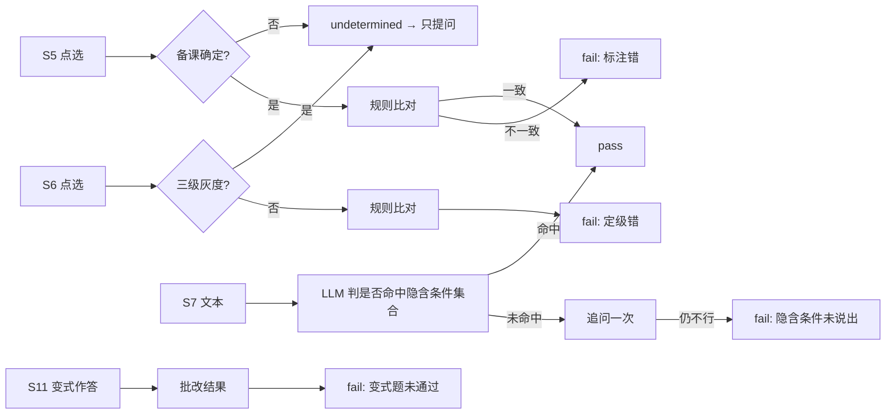

# 16. 错题诊断与变式/重练 — 数学审题逐题陪练

> 上游：11、14、15。下游：17、18、19、20。
> 本文覆盖样板的 26（诊断）+ 24（出题/变式）+ 28（复习/重练）三块，但按我们的产品做了裁剪：
> **没有题库、没有班级、没有考试；诊断对象是「审题流程节点」，不是「学科致错原因」。**

---

## 一、定位

| 系统 | 回答什么 | v1 |
|---|---|---|
| **卡点诊断** | 这次卡在 S5/S6/S7 的哪一步、是什么类型 | ✅ 记录骨架，判定受 Gate 0 限制 |
| **错题库** | 哪道题做错了、之后可以重做 | ✅ 数据结构 + 端点；v1 前端不展示 |
| **卡点记录库** | 长期画像：四类卡点各出现多少次 | ✅ 数据层 |
| **变式题** | 换一道同结构、条件更深一层的题，验证是否真读懂 | 🟡 首体验不触发；v2 实现生成/审核 |
| **重练** | 有没读透的题，就回来 | 🟡 后端 `GET /pending` 已建；前端入口 v2 |

**v1 的核心不是“诊断得多准”，而是“结构先定死、从第一天开始记”。**
11·§6·决策 4：维度长期稳定才有价值。

---

## 二、四类卡点（不是三类原因）

样板 26 的 `BarrierType` 是 **concept / reading / expression**——三个平行的“致错原因”。
我们的四类是 **S5→S6→S7→S12 的流程节点**，有顺序、有门控，**不能照搬“单题一个主因 + 三维占比”**。

| 卡点 | 触发 | 子类 | 主判方式 |
|---|---|---|---|
| **标注错** | S5 句子类型贴错 | — | 规则（备课 vs 点选）；备课「低」→ `undetermined` |
| **定级错** | S6 条件三级判错 | — | 规则；灰度区间不判 |
| **隐含条件未说出** | S7 追问一次后仍说不出 | **推一把过了 / 推一把也没过** | LLM 主判 + 规则辅助 |
| **变式题未通过** | S11 变式作答未通过（只在触发时） | — | 批改结果（规则） |

### 2.1 关键设计：一个事件，不是一张分数

```json
{
  "event_id": "CK-...",
  "session_id": "S-...",
  "step": "S5",
  "type": "标注错",
  "subtype": null,
  "result": "fail",
  "target_ref": "sentence:2",          // 内部证据，学生不可见
  "exposure": 5,                       // 走到该步的次数（分母）
  "attempt": 1,
  "visibility": "internal",
  "rule_version": "v1",
  "model": null,
  "created_at": "2026-10-29T..."
}
```

- **单次事件记所有失败节点**（multi-label），另设 `first_failed_node` 作为主归因。
- **画像分母用 `exposure`（走到该步的次数），不是“总失败数”**：变式是补考，只有失败者才做，直接用失败数做分母会高估。
- **学生投影只给 `{type, count, severity}`**；`target_ref` 只在内部。
- **`result` 三态**：`pass / fail / undetermined`；Gate 0 前大量是 `undetermined`，不要伪造成 `pass`。

---

## 三、诊断流程



### 3.1 规则与 LLM 的分工（与样板相反）

| 环节 | 样板 26 | 我们 |
|---|---|---|
| 标注/定级（点选） | LLM 主判 | **规则主判**；受备课确定性封顶 |
| 隐含条件（开放文本） | LLM 主判 | **LLM 主判 + 规则辅助** |
| 变式（作答） | — | 批改结果，不需要 LLM 归因 |

原因：S5/S6 有备课这个“标准答案”，规则比对更稳；S7 是开放文本，必须语义判断。
**所有 LLM 输出必须过枚举白名单 + JSON 提取 + 非法值不写库**（样板 26·§5.7 的做法）。

### 3.2 置信度

| 区间 | 教学动作 |
|---|---|
| 高（规则确定） | 正常反馈；可记录 `pass/fail` |
| 中（备课灰度） | **不判级，转提问**；记 `undetermined` |
| 低（P0 未过/模型不确定） | **不判对错，只提问**；不写 fail |

> 我们不把置信度落成学生可见的百分比；它只决定“判 / 不判 / 追问”。

---

## 四、两个库

### 4.1 错题库（学生的诊断资产）

| 项 | 内容 |
|---|---|
| 存什么 | 做错的原题 + 变式题（含学生解答；「错在哪」内部记录） |
| 谁能看 | 学生只看「**待再看的题**」清单；错因内部可见、不点名 |
| 用途 | 重做这道题 |
| 清账 | 重做一次 → 追加「重做」事件；不改写原记录 |
| 生命周期 | **只对有未清账目的学生成立**；「第二解法」是待验证假设，不是已成立结论 |

### 4.2 卡点记录库

| 项 | 内容 |
|---|---|
| 存什么 | 四类卡点事件（含 exposure / subtype / result） |
| 用途 | 针对某一类卡点再练几道；长期画像 |
| 永不“清零” | 它是画像，不是待办；不要拿它算“还有几件事没做” |
| 可见性 | 学生只看类型 + 次数；证据内部 |

> 11·§6·决策 7：错题库 = 学生诊断资产；不要叫学生「错题库」，学生侧叫「待再看的题」。

---

## 五、变式题系统

### 5.1 定位

**同情境、同结构，把条件等级改深一级**——直接→间接，或把明写条件藏进隐含。
它是**验收**，不是“再来一题”；只在 S5/S6/S7 有未通过时触发，**首体验不触发**。

### 5.2 流水线

```text
源题（学生拍的这一道）
  → 生成变式（同情境/同结构/条件加深）
  → 自校验（数据自洽、条件充分、无矛盾）
  → 审核（见 5.3）
  → 交付（学生端只出现审核通过的题）
```

**源题是唯一蓝本**：没有题库、没有 RAG、没有历史真题检索；`source_problem_id` 指向学生原题。
生成与审核分离：生成温度可高，审核必须保守。

### 5.3 审核维度（替代样板 24 的化学四维）

| 维度 | 检查什么 | 不通过 |
|---|---|---|
| **条件充分性** | 条件够不够解、有没有漏 | `blocked` |
| **数据自洽** | 数字/单位/数量关系不矛盾 | `blocked` |
| **陷阱保留** | 原题的审题陷阱还在不在 | `warning/blocked` |
| **年级适配** | 七年级课标、不引入超纲方法 | `warning` |
| **答案泄露** | 题面/提示不出现答案或完整解法 | `blocked` |

状态：`passed / warning / blocked`；`blocked` 打回重生成，`warning` 可展示但标记。

### 5.4 变式会话状态（v2）

```text
VARIANT_OFFERED → VARIANT_GENERATED → VARIANT_AUDITED → VARIANT_DELIVERED
       ↑                  │                  │
       └──── 拒绝/不触发 ──┘         blocked → 重生成
```

首体验：**不进入 `VARIANT_OFFERED`**；失败项记下来，下一次或可选后续再出。

---

## 六、重练与未清账目

| 端点 | 用途 | v1 |
|---|---|---|
| `GET /api/v1/pending` | 还有哪些错题没重做、哪些卡点反复出现 | ✅ 已建 |
| `POST /api/v1/wrong-items/done` | 把一道错题标成「重做过了」 | ✅ 已建 |
| 学生端入口 | 一个极简的「待再看的题」入口 | ❌ v2 |

**账与画像分开**：
- 未清错题 = 账，重做就清；`有账` 只看错题。
- 未清卡点 = 画像，不清零；不能算“还有几件事没做”。

---

## 七、与样板的关键差异

| 样板 | 我们 | 原因 |
|---|---|---|
| BarrierType 三原因，单题一主因 | 四流程节点，multi-label + first_failed_node | 审题是顺序流程，不是平行原因 |
| 教师班级聚合 | 学生个人 + 可选匿名聚合 | 无班级/教师端 |
| 题库/RAG/真题蓝本 | 学生原题作唯一蓝本 | 无题库 |
| 考试状态机 | 变式会话状态机 | 无考试 |
| 置信度阈值 + 人工复核 | 只决定判/不判/追问 | 实时教学，没有教师队列 |
| 分数/正确率 | 数量级 + 次数/暴露 | 「不给答案」与「不排名」 |

---

## 八、衔接

| 上游 | 消费 | 下游 | 产出 |
|---|---|---|---|
| 15 会话 | 每次作答的 verdict、卡点 | 17 工具 | `CheckpointEvent` |
| 11·§6·决策 2/3/4/7 | 触发条件、四类、两个库 | 18 数据模型 | 错题/卡点实体 |
| 14 可见性 | 学生只看数量级 | 19 API | `/pending`、`/wrong-items/done` |

> **下一份**：[17-Agent与工具契约](./17-Agent与工具契约.md)
