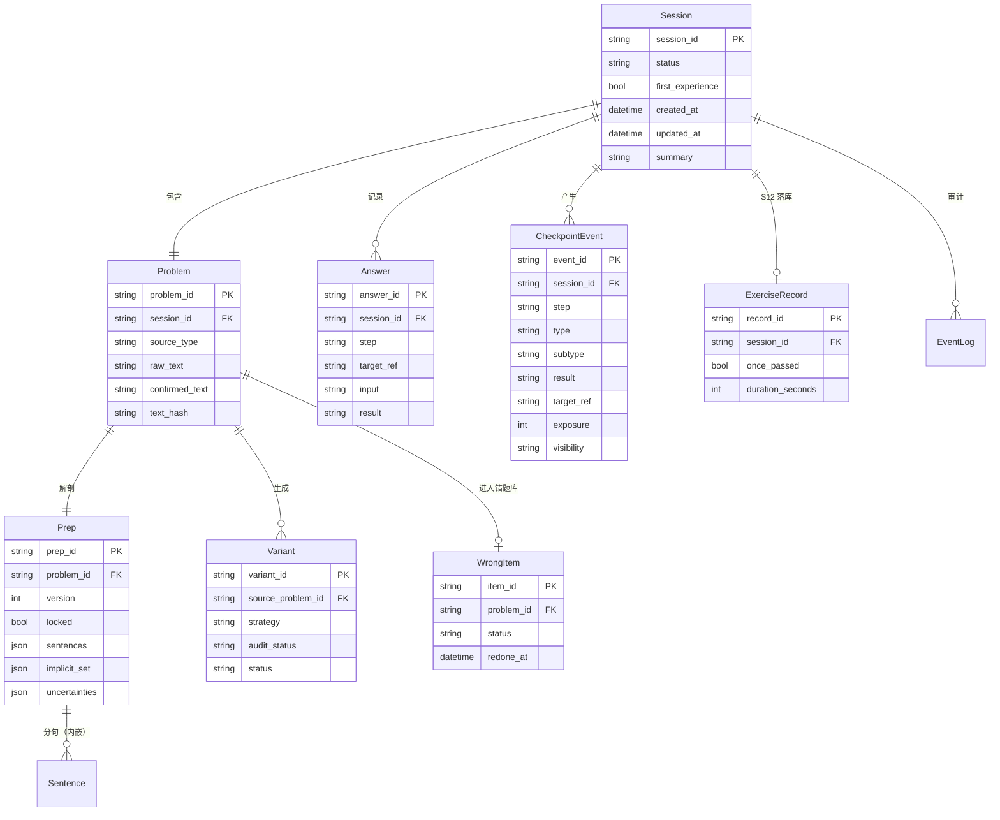

# 18. 数据模型设计 — 数学审题逐题陪练

> 上游：15、16、17。下游：19、20。
> 样板 33 号文用 ER + 24 实体 + 26 表；我们 v1 只有 **8 个核心实体、1 个聚合文档、4 个枚举族**。
> 原则：**值照 11 号文原话；字段名与类型是本文档的推断**（11 给的是名字，不是字段）。

---

## 一、总览



### 1.1 四条数据链

| 链 | 路径 | 用途 |
|---|---|---|
| **会话链** | Session → Problem → Prep → Sentence | 一次 S1—S8 的完整状态 |
| **判定链** | Session → Answer → CheckpointEvent | 每一步答了什么、卡在哪 |
| **资产链** | Problem → Variant / WrongItem | 变式与错题（v2 重练） |
| **记录链** | Session → ExerciseRecord → 两个库 | S12 落库与长期画像 |

---

## 二、实体与字段

### 2.1 Session（一次练习会话）

| 字段 | 类型 | 必填 | 说明 | 来源 |
|---|---|---|---|---|
| `session_id` | string | ✅ | `S-` + 12 位随机 | [推断] |
| `status` | enum | ✅ | 见 3.1 | 15·§4 |
| `first_experience` | bool | ✅ | 是否首体验（v1 都为 true） | 11·§6·决策 1 |
| `created_at` / `updated_at` | ISO8601 | ✅ | 带时区 | [推断] |
| `problem` | object | ❌ | Problem 聚合 | [推断] |
| `prep` | object | ❌ | Prep 聚合 | [推断] |
| `answers` | object | ✅ | 按步骤/目标的作答 | [推断] |
| `checkpoints` | array | ✅ | CheckpointEvent | 11·§6·决策 4 |
| `stuck` | array | ✅ | 40 秒记「卡住」的位置 | 11·§3.1 |
| `summary` | object | ❌ | S8 收束文本与统计 | [推断] |
| `error` | object | ❌ | 最近一次错误（code/message/at） | [推断] |

### 2.2 Problem（题目）

| 字段 | 类型 | 说明 |
|---|---|---|
| `problem_id` | string | `P-` + 随机 |
| `session_id` | string | 归属会话 |
| `source_type` | enum | `image` / `text` |
| `raw_text` | string | 读题/粘贴的原始文本 |
| `confirmed_text` | string | S2 学生确认后的文本；**后续唯一真源** |
| `text_hash` | string | confirmed_text 的哈希，用于去重/审计 |
| `image_ref` | string/null | v1 **不落原图**；只记一个临时引用或 null |

> 11·§3.2·S2：识别结果必须显式摆出、可改；confirmed_text 是后续备课的唯一输入。

### 2.3 Prep（备课解剖）

| 字段 | 类型 | 说明 |
|---|---|---|
| `prep_id` | string | `PR-` + 随机 |
| `problem_id` | string | 归属题目 |
| `version` | int | 从 1 开始；v1 只 1 版 |
| `locked` | bool | 成功后 true；**锁定后不再重读** |
| `sentences` | array | 每项：`i / text / type / level / confidence / note` |
| `implicit_set` | array | 隐含条件集合（多说法） |
| `uncertainties` | array | 不确定项 |
| `model` / `prompt_version` | string | 可追溯 |
| `created_at` | ISO8601 | — |

> 值：`type ∈ {背景,条件,问题,指令}`；`level ∈ {直接,间接,隐含}`；`confidence ∈ {高,中,低}`（11·§4.1 F2/F4/F5）。

### 2.4 Answer（一次作答）

| 字段 | 类型 | 说明 |
|---|---|---|
| `answer_id` | string | `A-` + 随机 |
| `session_id` | string | 归属 |
| `step` | enum | `S5` / `S6` / `S7` |
| `target_ref` | string | `sentence:<i>` / `condition:<i>` / `implicit` |
| `input` | string | 学生点选值 / 文本 / 「我说不出来」 |
| `result` | enum | `一致 / 不一致 / 不判定` |
| `basis` | string | 判定依据（内部；学生可见的会过滤） |
| `source` | string | `F2` / `未上线` / `超时` |
| `created_at` | ISO8601 | — |

### 2.5 CheckpointEvent（卡点事件）

| 字段 | 类型 | 说明 |
|---|---|---|
| `event_id` | string | `CK-` + 随机 |
| `session_id` | string | 归属 |
| `step` | enum | S5/S6/S7/S11 |
| `type` | enum | 标注错/定级错/隐含条件未说出/变式题未通过 |
| `subtype` | enum/null | 推一把过了 / 推一把也没过 |
| `result` | enum | `pass / fail / undetermined` |
| `target_ref` | string | 内部证据（句子/条件 id） |
| `exposure` | int | 走到该步的次数（分母） |
| `attempt` | int | 第几次尝试 |
| `visibility` | enum | `internal` / `student` |
| `rule_version` / `model` | string | 可追溯 |
| `created_at` | ISO8601 | — |

> 16·§2：单次事件 multi-label；学生投影只给 `{type,count,severity}`。

### 2.6 Variant（变式题）

| 字段 | 类型 | 说明 |
|---|---|---|
| `variant_id` | string | `V-` + 随机 |
| `source_problem_id` | string | 学生原题（唯一蓝本） |
| `strategy` | enum | 直接→间接 / 明写→隐含 / 数值变体 |
| `text` | string | 变式题面 |
| `audit_status` | enum | `passed / warning / blocked` |
| `audit_report` | object | 条件充分性/数据自洽/陷阱保留/年级适配/答案泄露 |
| `status` | enum | `offered / generated / audited / delivered / rejected` |
| `created_at` / `delivered_at` | ISO8601 | — |

### 2.7 WrongItem（错题 / 待再看的题）

| 字段 | 类型 | 说明 |
|---|---|---|
| `item_id` | string | `WI-` + 随机 |
| `problem_id` | string | 原题 |
| `source` | enum | 原题 / 变式题 |
| `problem_text` | string | 题面 |
| `student_solution` | string | 学生解答（识别后文本；v2） |
| `checkpoint_refs` | array | 错在哪（内部） |
| `status` | enum | `open / done` |
| `created_at` / `redone_at` | ISO8601 | — |

### 2.8 ExerciseRecord（S12 练习记录）

| 字段 | 类型 | 说明 |
|---|---|---|
| `record_id` | string | `EX-` + 随机 |
| `session_id` | string | 归属会话 |
| `problem_text` | string | 确认后的题目 |
| `started_at` / `ended_at` | ISO8601 | 带时区 |
| `duration_seconds` | int | 总时长照常记录，不作为设计目标 |
| `once_passed` | bool | 本次是否一次通过（所有人记） |
| `checkpoints` | array | 四类卡点 |
| `wrong_items` | array | 错题（v2） |

### 2.9 EventLog（审计）

| 字段 | 类型 | 说明 |
|---|---|---|
| `event_id` | string | `E-` + 随机 |
| `session_id` | string | 归属 |
| `type` | string | session.created / prep.locked / answer.recorded / ... |
| `payload` | object | 脱敏后 |
| `created_at` | ISO8601 | — |

> **状态：已定义，未实现。** 当前代码只写会话 JSON（`store/session_store.py`），不写 `session_events.jsonl`（25·D7）。

---

## 三、枚举

### 3.1 会话状态

`CREATED / READING / CONFIRMING / PREPARING / READY / ANNOTATING / GRADING_CONDITIONS / PROBING_IMPLICIT / CLOSING / CLOSED / DISCARDED / ERROR`

### 3.2 题目/判定

| 枚举 | 值 |
|---|---|
| 句子类型 | 背景 / 条件 / 问题 / 指令 |
| 条件级别 | 直接 / 间接 / 隐含 |
| 判定结果 | 一致 / 不一致 / 不判定 |
| 题目来源 | image / text |
| 变式策略 | 直接→间接 / 明写→隐含 / 数值变体 |
| 审核状态 | passed / warning / blocked |

### 3.3 卡点

| 枚举 | 值 |
|---|---|
| 卡点类型 | 标注错 / 定级错 / 隐含条件未说出 / 变式题未通过 |
| 隐含子类 | 推一把过了 / 推一把也没过 |
| 结果 | pass / fail / undetermined |
| 可见性 | internal / student |

---

## 四、存储（v1 极薄）

| 数据 | 形式 | 位置 |
|---|---|---|
| 会话 | 一个会话一个 JSON 文档 | `data/sessions/<session_id>.json` |
| 审计事件 | 追加式 JSONL（已定义未实现） | `data/session_events.jsonl` |
| 练习记录 | 追加式 JSONL | `data/exercises.jsonl` |
| 卡点 | 追加式 JSONL | `data/beads.jsonl` |
| 错题 | 追加式 JSONL | `data/wrong_items.jsonl` |

- 会话文档写入：临时文件 + `rename`（原子替换）；进程内一把锁。
- 事件/记录：append-only；坏行跳过，不让一行坏 JSON 拖垮整个库。
- **审计事件例外**：`session_events.jsonl` 已定义但未实现；当前只有会话 JSON 落盘（25·D7）。
- v1 无数据库；这是 11·§8.2 选 A 的直接结果。数据量/并发上来再换 SQLite。

---

## 五、可见性投影

```python
# 内部
{"type": "标注错", "target_ref": "sentence:2", "result": "fail"}

# 学生投影
{"type": "标注错", "count": 1, "severity": "low"}
```

- `target_ref`、`basis` 中的具体句子/条件、`evidence` 永远不进入学生响应。
- `answer` / `solution` / `final_value` **在数据模型里不存在**；模型输出若带，`audit.py` 剥离。
- 家长/教师投影只到类型/时间维度（v2）。

---

## 六、与样板 33 的差异

| 样板 | 我们 |
|---|---|
| 学校/年级/班级/教师/家长/账户 | 无；会话即隔离单位 |
| 考试/题目/作答/题库/真题 | 无题库；Problem 是学生带来的题 |
| 24 实体 / 26 表 | 8 实体 / 1 会话文档 + 4 个 JSONL |
| 多租户隔离 | 会话级隔离 + 字段级可见性 |
| 错因三分类 | 四流程节点 + 证据/可见性 |

---

> **下一份**：[19-API设计](./19-API设计.md)

---

## 沿革

- **2026-10-30**：按 25·§2.2 修正 D7（`session_events.jsonl` 标为已定义未实现）。
